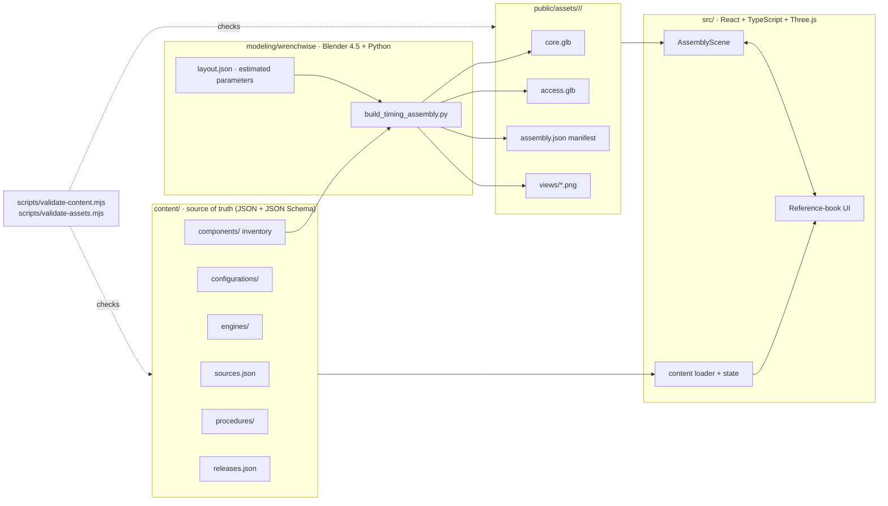

# Wrenchwise architecture and implementation plan

Status: adopted 2026-10-29 · applies from release `r1` onward.

Wrenchwise is an interactive reference book for under-the-hood work. The core path is:

**configuration → job → preparation → steps linked to 3D components → final checks.**

This document records the repository audit, the target architecture, and the prioritized plan. It supersedes the
navigation described in older `docs/s160-*` notes; those files remain as history.

## 1. Repository audit (2026-10-29, commit `10a2770`)

### Reusable

| Area | What exists | Decision |
| --- | --- | --- |
| Build/deploy | Vite static build (`vite.pages.config.ts`), GitHub Pages workflow with post-deploy verification (`scripts/verify-deployment.mjs`), deployment manifest | Keep. Add new routes and content validation to the pipeline. |
| Viewer helpers | `lib/viewer-interaction.mjs` (material highlight, visible-hit filtering, resize) | Reuse in the new scene controller. |
| Research | `research/s160-mechanical-sources.json`, `research/s160-factory-reference-audit.json`, `research/s160/reference-configuration.json` | Migrate into the source registry with usage-rights fields. |
| Procedure research | `lib/timing-belt-lesson.ts` (RM718U page-level summary of the timing-belt chapter) | Migrate into structured procedure content. Keep page locators; drop deep links to unauthorized mirrors. |
| Legacy pages | `/workshop`, `/catalog`, `/assembly`, `/components`, `/library`, `/research` | Keep working at their URLs as an archive. Not linked from the primary flow except "Archive". |

### Gaps

1. **Content is hardcoded in TypeScript** (`lib/timing-belt-lesson.ts`, `lib/s160-service.ts`). There is no schema, no
   per-step assembly state, no specifications model, and no completion checks.
2. **No component inventory with separate verification axes.** `gs300-parts.json` uses a single `accuracy` flag. Identity,
   dimensions, placement, fitment and procedure are not tracked separately.
3. **The 3D asset is a 10.7 MB whole-vehicle GLB** with 513 grouped meshes. Timing parts are mixed with body/exterior
   geometry and there's no progressive loading. Its Blender source is not reproducible from this repository alone.
   The build depends on a previous GLB's SHA-256.
4. **Several references are unauthorized manual mirrors** (charm.li, carmanualsonline, zinref). They were used to locate
   factory page numbers and are linked directly from the UI. Their usage rights are not recorded.
5. **Scope sprawl:** 817 catalog records, exterior bodies and community uploads, none of which serve the core path.
6. **Code style:** dense single-line components that are hard to review or test.

### Content limitations, carried forward honestly

- No physical engine, donor part, scan or licensed CAD is available. **No dimension in the model is measured.**
- Factory procedure text was read from third-party mirrors, not from licensed TIS. No torque values or timing
  specifications are entered.
- OEM part numbers have not been established from an OEM catalog for this VIN range.

## 2. Target architecture

### 2.1 Content model

All of these are validated by JSON Schema (`content/schema/`) and by cross-reference checks
(`scripts/validate-content.mjs`).

- **Source**: id, publisher, document and locator, revision, applicable configurations, kind, access state,
  usage rights (`licensed`, `cc-by`, `reference-only`, `unauthorized-mirror`, `unknown`) and permitted uses
  (`identity`, `appearance`, `routing`, `dimensions`, `procedure`, ...). Exploded diagrams are permitted for
  `identity`/`relationship` only and never for `dimensions`.
- **Configuration**: make, model, chassis, year, market, steering, engine variant, transmission and unresolved variants.
- **Engine variant**: a code plus variant plus market. It is never just a family name. It records explicit
  non-equivalences such as "not interchangeable with 1993–97 non-VVT-i 2JZ-GE timing components".
- **Component**: stable id, name, system, parent, `kind` (`part`, `assembly`, `fastener-set`, `group`), quantity,
  applicability, OEM part number, dimensions, placement, mesh ids, procedure step ids, sources, gaps, and a
  `verification` record with five **independent** axes: `identity`, `dimensions`, `placement`, `fitment` and
  `procedure`.
- **Procedure**: configuration, content status (`educational-overview` or `verified`), preparation (checklist,
  tools, parts, cautions), steps and final checks. Each step defines instruction, prerequisites, component ids,
  tools, replacement parts, specifications (value, unit, source, status), assembly-state deltas, camera, cautions,
  completion checks and gaps.

### 2.2 Assembly state

Each step has a `view`: `remove` and `restore` (procedural, cumulative), plus `hide`, `highlight`, `ghost` and `camera`
(viewing aids, step-local). The state at step *n* is a pure fold over steps `0..n` (`src/content/assembly-state.ts`).
Backward navigation and resume therefore always produce the same scene. Procedural removal and viewing aids are
rendered differently and listed separately in the UI.

### 2.3 Modeling pipeline

`modeling/wrenchwise/build_timing_assembly.py` runs headless in Blender 4.5. It reads the component inventory and
`layout.json`, then produces:

- Authoring output (`.blend`, not served) and browser output (`core.glb` for the timing drive, `access.glb` for
  parts removed for access). Each output gets a manifest with revision, triangle counts and a SHA-256 hash.
- One Blender object per selectable component. The object name equals the mesh id, and glTF `extras` carry
  `componentId`, `meshId` and `modelRevision`. Repeated fasteners share mesh data, so the exporter de-duplicates them.
- Neutral-lit review renders that also act as the static illustration fallback.

`layout.json` holds every geometric parameter with an evidence status. Values marked `estimated` came from
photograph proportions and can't be used for dimensional claims. The validator rejects any "measured" status that
has no measurement source.

### 2.4 Application

- `pages/main.tsx` routes `/` (the reference-book index) and `/guide/` (procedure workspace). Legacy routes are unchanged.
- `src/viewer/assembly-scene.ts` is a framework-free Three.js controller. It handles loading, orbit, camera presets,
  raycast, highlight, isolate, ghost, visibility and explanatory explode. React talks to it through a small typed API.
- `src/ui/*` holds the white, minimal UI. Desktop shows contents, instructions and 3D together. Mobile has Guide/3D tabs.
- Progress persists in `localStorage` under a key that includes the procedure id and revision. An incompatible revision
  starts clean rather than restoring the wrong step.

## 3. Prioritized plan

| # | Deliverable | Acceptance |
| --- | --- | --- |
| 1 | This document | Audit and decisions recorded |
| 2 | Schemas, source registry, configuration, engine variant, inventory | `validate-content` passes, every component traceable to sources, gaps explicit |
| 3 | Prototype: timing-belt procedure ↔ selectable assembly | Step changes drive scene state, two-way selection |
| 4 | Blender-built timing-drive geometry r1 + review renders | `validate-assets`: ids, scale, materials, budgets |
| 5 | Responsive UI, persistence, search, text alternative | Desktop and mobile flows, resume after reload |
| 6 | Unit, content, asset and browser tests, plus CI/Pages verification | Green CI, deployed SHA verified |
| 7 | `docs/ADDING_CONTENT.md` | A new engine/procedure can be added without code changes |

### Next after r1 (requires physical evidence)

1. Obtain licensed TIS access for RM718U and replace mirror-derived locators with verified citations, specs and torque.
2. Establish OEM part numbers from the Lexus EPC for the target production range.
3. Measure the pulley pitch diameters, cover mounting points and tensioner body on a physical engine, then promote
   `layout.json` entries from `estimated` to `measured`.
4. Qualified technician review of sequence and physical access, recorded in `content/reviews/`.

