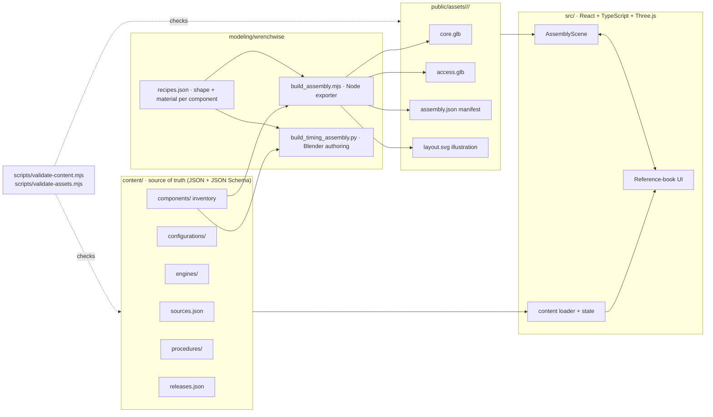

# Wrenchwise architecture and implementation plan

Status: adopted 2026-10-29 · applies from release `r1` onward.

Wrenchwise is an interactive reference book for under-the-hood work. The core path is:

**configuration → job → preparation → steps linked to 3D components → final checks.**

This document records the repository audit, the target architecture, and the prioritized plan. It supersedes the
navigation described in older `docs/s160-*` notes; those files remain as history.

## 1. Repository audit (2026-10-29, commit `10a2770`)

### Reusable

| Area | What exists | Decision |
| --- | --- | --- |
| Build/deploy | Vite static build (`vite.pages.config.ts`), GitHub Pages workflow with post-deploy verification (`scripts/verify-deployment.mjs`), deployment manifest | Keep. Add new routes and content validation to the pipeline. |
| Viewer helpers | `lib/viewer-interaction.mjs` (material highlight, visible-hit filtering, resize) | Reuse in the new scene controller. |
| Research | `research/s160-mechanical-sources.json`, `research/s160-factory-reference-audit.json`, `research/s160/reference-configuration.json` | Migrate into the source registry with usage-rights fields. |
| Procedure research | `lib/timing-belt-lesson.ts` (RM718U page-level summary of the timing-belt chapter) | Migrate into structured procedure content. Keep page locators; drop deep links to unauthorized mirrors. |
| Legacy pages | `/workshop`, `/catalog`, `/assembly`, `/components`, `/library`, `/research` | Keep working at their URLs as an archive. Not linked from the primary flow except "Archive". |

### Gaps

1. **Content is hardcoded in TypeScript** (`lib/timing-belt-lesson.ts`, `lib/s160-service.ts`). There is no schema, no
   per-step assembly state, no specifications model, and no completion checks.
2. **No component inventory with separate verification axes.** `gs300-parts.json` uses a single `accuracy` flag. Identity,
   dimensions, placement, fitment and procedure are not tracked separately.
3. **The 3D asset is a 10.7 MB whole-vehicle GLB** with 513 grouped meshes. Timing parts are mixed with body/exterior
   geometry and there's no progressive loading. Its Blender source is not reproducible from this repository alone.
   The build depends on a previous GLB's SHA-256.
4. **Several references are unauthorized manual mirrors** (charm.li, carmanualsonline, zinref). They were used to locate
   factory page numbers and are linked directly from the UI. Their usage rights are not recorded.
5. **Scope sprawl:** 817 catalog records, exterior bodies and community uploads, none of which serve the core path.
6. **Code style:** dense single-line components that are hard to review or test.

### Content limitations, carried forward honestly

- No physical engine, donor part, scan or licensed CAD is available. **No dimension in the model is measured.**
- Factory procedure text was read from third-party mirrors, not from licensed TIS. No torque values or timing
  specifications are entered.
- OEM part numbers have not been established from an OEM catalog for this VIN range.

## 2. Target architecture

### 2.1 Content model

All of these are validated by JSON Schema (`content/schema/`) and by cross-reference checks
(`scripts/validate-content.mjs`).

- **Source**: id, publisher, document and locator, revision, applicable configurations, kind, access state,
  usage rights (`licensed`, `cc-by`, `reference-only`, `unauthorized-mirror`, `unknown`) and permitted uses
  (`identity`, `appearance`, `routing`, `dimensions`, `procedure`, ...). Exploded diagrams are permitted for
  `identity`/`relationship` only and never for `dimensions`.
- **Configuration**: make, model, chassis, year, market, steering, engine variant, transmission and unresolved variants.
- **Engine variant**: a code plus variant plus market. It is never just a family name. It records explicit
  non-equivalences such as "not interchangeable with 1993–97 non-VVT-i 2JZ-GE timing components".
- **Component**: stable id, name, system, parent, `kind` (`part`, `assembly`, `fastener-set`, `group`), quantity,
  applicability, OEM part number, dimensions, placement, mesh ids, procedure step ids, sources, gaps, and a
  `verification` record with five **independent** axes: `identity`, `dimensions`, `placement`, `fitment` and
  `procedure`.
- **Procedure**: configuration, content status (`educational-overview` or `verified`), preparation (checklist,
  tools, parts, cautions), steps and final checks. Each step defines instruction, prerequisites, component ids,
  tools, replacement parts, specifications (value, unit, source, status), assembly-state deltas, camera, cautions,
  completion checks and gaps.

### 2.2 Assembly state

Each step has a `view`: `remove` and `restore` (procedural, cumulative), plus `hide`, `highlight`, `ghost` and `camera`
(viewing aids, step-local). The state at step *n* is a pure fold over steps `0..n` (`src/content/assembly-state.ts`).
Backward navigation and resume therefore always produce the same scene. Procedural removal and viewing aids are
rendered differently and listed separately in the UI.

### 2.3 Modeling pipeline

Two builders read the same two inputs — the component inventory (every dimension and position, each with its
evidence status) and `modeling/wrenchwise/recipes.json` (which shape and material each component uses):

- `build_assembly.mjs` (Node) produces the browser assets: `core.glb` for the engine structure and timing drive,
  `access.glb` for the assemblies removed for access, `assembly.json` (hashes, triangle counts, per-component
  records, build notes) and `layout.svg`, the front-elevation schematic used as the illustration fallback. It runs
  in CI with `--check`, so a content change that was never re-exported fails the build.
- `build_timing_assembly.py` runs headless in Blender 4.5 for authoring work that needs modifiers or rendering. Its
  shape vocabulary mirrors `lib/primitives.mjs` vertex for vertex. The scene is authored directly in the glTF frame,
  so the exporter runs with `export_yup=False`.

One glTF node per selectable component mesh. The node name equals the mesh id, and `extras` carry `componentId`,
`meshId` and `modelRevision`. No glTF extensions are used, so no decoder is required to open the asset.

The recipe file contains no dimensions. Its constants — wall thicknesses, tooth pitch, rib pitch, segment counts —
are tessellation choices and are reported as such in the manifest, never as part data. `validate-content` rejects a
`measured` dimension status whose sources do not permit dimensional use.

### 2.4 Application

- `pages/main.tsx` routes `/` (the library) and `/job/` (a job worked against the model; `/guide/` resolves to the
  same page so shared links keep working). The earlier exploration workspace moved to `/archive/`; every other
  legacy route is unchanged and still linked from there.
- `src/content/catalog.ts` discovers content with `import.meta.glob`, so adding a configuration, engine or procedure
  needs no code change. `src/content/procedure-state.mjs`, `search.mjs` and `library.mjs` hold the pure logic, so all
  three are unit tested in Node without a browser.
- The library page is built from `library.mjs`: an engine appears once it has a component inventory, and every
  variant an engine's `notEquivalentTo` rules out becomes a coverage entry with its reason. The unit of coverage is
  an engine variant in a recorded configuration, so a vehicle is a property of an engine entry rather than the
  subject of the interface, and the mechanical rule that a family name is not a parts list becomes navigation.
- `src/viewer/assembly-scene.ts` is a framework-free Three.js controller and does more than display geometry, because
  the model is the interface: progressive layer loading, animated camera flights between steps, screen-space
  projection of part anchors for the DOM hotspot overlay (with an occlusion test), a lateral framing bias so the
  subject clears whichever panels are open, raycast selection and hover, isolate with ghosting, explanatory
  separation, keyboard and touch control. Lighting reflects a purpose-built **dark studio** environment: metal has no
  diffuse term, so a bright environment makes every machined surface read as light grey plastic and no environment
  at all makes it black. Materials are cloned per mesh so highlighting cannot leak between components.
- `src/ui/*` holds the interface. The model fills the viewport; a floating glass card carries one step at a time and
  can be collapsed, becoming a bottom sheet below 760px. Plain language and the step's own checks are on the surface;
  specifications, tools, sources, gaps and the assembly delta sit in `
` folds — except cautions and
  warnings, which never collapse. Hotspots are rendered by React but positioned imperatively from the render loop,
  so orbiting costs no React renders; overlapping labels are de-collided vertically. Loading, error, retry and
  no-WebGL states all fall back to the generated illustration plus the full step text.
- While a step is open the scene shows the state *entering* it (`computeAssemblyState(..., { pending: true })`): the
  parts the step removes are still fitted and highlighted, and they disappear on advancing. Without this the step
  that names a part is the first step in which that part is already gone.
- Progress persists in `localStorage` under a key that includes the procedure id and revision. An incompatible
  revision, a corrupt value or an unknown check id starts clean rather than restoring the wrong step.

## 3. Prioritized plan

| # | Deliverable | Acceptance | Status |
| --- | --- | --- | --- |
| 1 | This document | Audit and decisions recorded | done |
| 2 | Schemas, source registry, configuration, engine variant, inventory | `validate-content` passes, every component traceable to sources, gaps explicit | done — 6 schemas, 9 sources, 37 components |
| 3 | Prototype: timing-belt procedure ↔ selectable assembly | Step changes drive scene state, two-way selection | done — 16 steps, 26 components bound |
| 4 | Timing-drive geometry r1 + illustration | `validate-assets`: ids, scale, materials, budgets | done — 44 meshes, 8,456 triangles, 697 KB over two layers |
| 5 | Responsive UI, persistence, search, text alternative | Desktop and mobile flows, resume after reload | done |
| 6 | Unit, content, asset and browser tests, plus CI/Pages verification | Green CI, deployed SHA verified | done — 3 new unit suites, 6 new browser specs, 3 new CI steps |
| 7 | `docs/ADDING_CONTENT.md` | A new engine/procedure can be added without code changes | done — content discovered by glob |

Release contents, evidence status and open gaps for each release are recorded in `content/releases.json` and
rendered on the index page.

### Next after r1 (requires physical evidence)

1. Obtain licensed TIS access for RM718U and replace mirror-derived locators with verified citations, specs and torque.
2. Establish OEM part numbers from the Lexus EPC for the target production range.
3. Measure the pulley pitch diameters, cover mounting points and tensioner body on a physical engine, then promote
   `layout.json` entries from `estimated` to `measured`.
4. Qualified technician review of sequence and physical access, recorded in `content/reviews/`.

